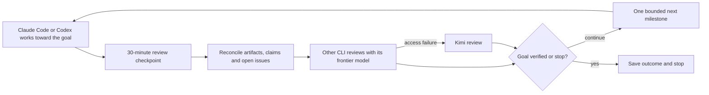

# ccloop

Give Claude Code or Codex a goal. The active client works toward it, asks the
other CLI for review, verifies the next milestone, and repeats until the original
criteria are met or a stopping condition is reached. If a selected participant
cannot be accessed, use Kimi with the saved goal and evidence.

| Driver | Reviewer | Reviewer access fallback |
| --- | --- | --- |
| Claude Code | Codex | Kimi |
| Codex | Claude Code | Kimi |
| Kimi handoff | Claude Code, then Codex | Save checkpoint if neither is available |

The skill is [SKILL.md](SKILL.md). A dependency-free Python helper keeps a private
ledger, original criteria, claim/issue continuity, artifact hashes and actual CLI
attempts. It is based on the durable controller from the previous desktop loop.
The current CLI workflow needs no desktop UI or hourly scheduler.

The original package format is retained: `SKILL.md`, `agents/`, `assets/`,
`references/`, `scripts/` and `tests/`. Private supervisor runs keep `CONTROL.md`,
`state.json`, numbered review/prompt/observation artifacts, and bounded stopping
conditions. The CLI transport and model routing extend that existing workflow.



## Install

From this repository, link the skill into both clients' personal skill directories:

```bash
python3 - <<'PY'
from pathlib import Path
source = Path.cwd().resolve()
targets = [Path.home()/'.agents/skills/ccloop', Path.home()/'.claude/skills/ccloop']
for target in targets:
    if target.is_symlink() and target.resolve() == source:
        continue
    if target.exists() or target.is_symlink():
        raise SystemExit(f'Preserve the existing installation: {target}')
for target in targets:
    if not target.is_symlink():
        target.parent.mkdir(parents=True, exist_ok=True)
        target.symlink_to(source, target_is_directory=True)
PY
```

This preserves existing destinations, including dangling links and directories.
Use your client's discovery directory if it differs. See the official
[Codex skill locations](https://developers.openai.com/codex/skills/) and
[Claude Code skill locations](https://code.claude.com/docs/en/skills).
Installing the skill starts no goal or background process.

## Set a goal

In Codex:

```text
$ccloop Fix the parser while preserving every existing input format.
Success requires the integration and regression checks to pass.
```

In Claude Code:

```text
/ccloop Fix the parser while preserving every existing input format.
Success requires the integration and regression checks to pass.
```

To pin the **driver** to its frontier model from the terminal:

```bash
python3 scripts/launch.py --driver codex --project /work/project \
  --goal 'Fix the parser while preserving every existing input format'
python3 scripts/launch.py --driver claude --project /work/project \
  --goal 'Fix the parser while preserving every existing input format'
```

The launcher checks selected-model access with a small tool-free readiness call,
then preserves normal interactive CLI permissions for project work. The readiness
timeout defaults to five minutes. Startup authentication, usage/model-access and
service failures can use Kimi. `--dry-run` shows the command without calling a
model. A running session's model is controlled by that client; skill text cannot
silently change it. Mid-session service failure may require starting Kimi with
the saved root:

```bash
python3 scripts/launch.py --driver kimi --project /work/project \
  --goal 'The original goal' --root /work/private-supervisor
```

Current defaults, verified 2026-10-20: Claude `claude-fable-5-1` / `max`, Codex
`gpt-6-astra` / `max`, Kimi `kimi-code/k3` / thinking. Explicit launcher model
overrides pin a chosen profile; omit them for automatic updates. See
[model selection and sources](references/models.md).

## What happens during the loop

1. Save the original goal, criteria, scope and bounded limits in a private ledger.
2. Ask the other CLI to review the plan using supplied source excerpts and evidence.
3. Work on bounded milestones and review current results every **30 minutes** by
   default, with an immediate final review when the original goal is established.
4. Reconcile new findings with prior claims and open objections, then continue.
5. Perform final verification and final cross-review. Completion requires every
   original criterion met and no open blocking issue.

Authentication, usage/rate limits, unavailable selected models, missing binaries,
service outages and timeouts may use the designated fallback. Failed tests and
invalid reviewer reports keep their real failure classification. Requested and
observed models are recorded separately; unsupported observed-model metadata is
left unknown. There is no silent smaller-model substitution.

The strongest model profile refreshes automatically from official metadata and
local model lists. Updates retain the original goal and remaining budget; an
unavailable metadata source keeps the last verified profile with a warning.
Reviewer selection refreshes during the run; a driver update takes effect when
the client next launches or hands off. CLI binaries are not upgraded automatically.

Use [the config template](assets/ccloop.config.example.json) and
[CLI protocol](references/cli-protocol.md) for setup, packets, reports, stop/resume
and handoff commands. Defaults are 12 consultation rounds, two hours, three
no-progress milestone reviews, a 300-second consultation timeout, and a 30-minute
review interval. The active client honors due-review status; this does not create
a background scheduler.

```bash
python3 scripts/ccloop.py doctor
python3 scripts/ccloop.py --root /work/private-supervisor init --config /work/run.json
python3 scripts/ccloop.py --root /work/private-supervisor consult \
  --packet /work/private-supervisor/plan.json --stage plan
python3 scripts/ccloop.py --root /work/private-supervisor status
```

## Requirements and limits

Python 3.10+ on Linux/macOS (or Linux under WSL), and authenticated Claude Code,
Codex and Kimi CLIs. Python 3.11+ is recommended for Kimi's TOML preflight. Account
model entitlements and existing service limits apply. No account or paid-usage
settings are changed by the helper.

The active client runs the work. Closing it does not leave an autonomous service
running. Two model opinions are not a correctness proof. The driver still checks
the evidence, normal project permissions apply, and watch globs define artifact
drift coverage. Reviewers receive frozen packets outside the project with no
editing role; Kimi hooks/plugins that could add tools are rejected.

The old UI workflow is archived as [the legacy desktop skill](references/legacy-desktop/SKILL.md).
Its [controller](scripts/control.py), [protocol](references/protocol.md), and
existing ledger format remain available. Use a new supervisor root for ccloop.

## Verification

```bash
python3 -m unittest discover -s tests -v
uv run --no-project --with pyyaml python /path/to/skill-creator/scripts/quick_validate.py .
```

Integration tests use temporary fake CLI executables to verify routing, report
validation, fallback, budgets, model handling and interruption behavior. They do
not submit live project work. Real service access must be distinguished from
authentication and simulated test results.

Runtime state, actual prompts, transcripts and artifacts belong outside this
repository. Licensed under the [MIT License](LICENSE).
